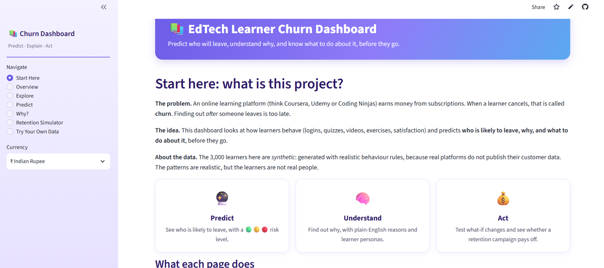
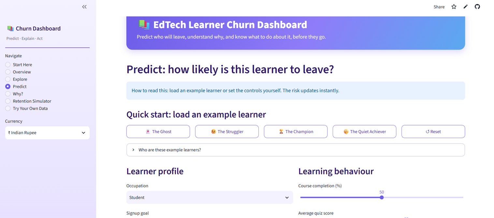
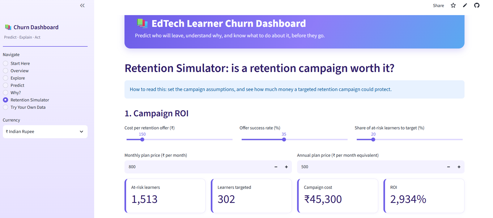

# 📚 EdTech Learner Churn Prediction Dashboard

An interactive dashboard that predicts which learners on a subscription learning platform (think Coursera, Udemy or Coding Ninjas) are likely to cancel, explains **why**, shows **when** they leave, and suggests **what to do about it**.

🔗 **Live demo:** (https://edtech-churn-dashboard.streamlit.app/)
> **Note:** the dataset is **synthetic** (3,000 generated learners). Real platforms do not publish customer data, so I designed behaviour rules based on realistic assumptions. The results show how the method works, not how a real company behaves.

## Screenshots





## What it does

| Page | What you can do |
|---|---|
| **Start Here** | Learn what churn is, try guided experiments, read the glossary |
| **Overview** | See key stats and the biggest churn patterns |
| **Explore** | Compare churn across plans, goals, occupations and behaviours |
| **Predict** | Describe any learner (or load an example) and get a 🟢🟡🔴 risk level |
| **Why?** | See what drives churn overall and the reasons behind one learner's risk, plus their persona |
| **Model Performance** | Confusion matrix, precision, recall, F1 and AUC on 600 unseen learners, an adjustable decision threshold, and a cost-of-mistakes calculator |
| **Survival Curves** | Kaplan-Meier retention curves by plan, goal, occupation or discount, with a "% still subscribed at day X" readout |
| **Retention Simulator** | Estimate the ROI of a retention campaign (₹ or $) and test what-if changes for a learner |
| **Try Your Own Data** | Upload a CSV and score a whole list of learners; download the results |

## Key features

- **Risk tiers, not just yes/no:** Low (<30%), Medium (30-70%), High (>70%) so each learner gets a proportionate response
- **Learner personas:** at-risk learners are grouped with K-Means into 4 personas (Passive Coaster, Goal-Focused Drifter, Quiet Achiever, Struggling but Trying), each with a recommended action
- **Plain-English explanations:** each prediction lists its biggest risk factors in words
- **Honest evaluation:** metrics are computed only on the held-out test set, with a threshold slider and a cost calculator that finds the cheapest threshold
- **Survival analysis:** Kaplan-Meier curves (written from scratch in pandas) show when learners leave, not just whether they leave
- **What-if simulator:** change one factor (for example hands-on exercises) and see the risk move
- **Retention ROI:** learners are ranked by churn risk × lifetime value to see where a campaign pays off
- **Batch scoring:** upload a CSV, get a sorted "who to contact first" list

## Data and features

3,000 synthetic learners, 23% churn rate, with 23 model inputs covering:

- **Profile:** occupation, signup goal, plan type, signup discount
- **Engagement:** days since last login, engagement trend, course completion
- **Learning behaviour:** quiz scores, video replays, hands-on exercises, projects, forum posts, goal progress
- **Commercial and support:** tenure, payment failures, support tickets, satisfaction

## Model results

Evaluated on a held-out test set of 600 learners (80/20 stratified split):

| Model | Accuracy | Churner recall | Churner precision |
|---|---|---|---|
| Logistic Regression | 83.5% | 54% | 68% |
| Logistic Regression (balanced) | 77% | **75%** | 50% |
| Random Forest | 82% | 67% | 60% |
| XGBoost | 81% | 64% | 58% |

**Chosen model: balanced Logistic Regression.** For churn, missing a learner who leaves costs more than sending an unneeded retention offer, so I optimised for recall over accuracy. The simpler model won because the synthetic data has clean, additive patterns.

**A bug worth mentioning:** the what-if simulator once showed risk *rising* after a positive change. The cause was multicollinearity (`peer_completion_percentile` overlapped with course completion and got a wrong-signed coefficient). I removed it, and recall and precision stayed the same.

## Survival analysis

Learners who never churned are treated as observed for 365 days and then *censored* (still subscribed when follow-up ended). Kaplan-Meier estimates on the synthetic data show:

- About **86% of churn happens within the first 100 days**, and 45% within the first 30 days
- After 90 days, about **86% of annual-plan learners** are still subscribed versus **76% of monthly-plan learners**
- Signup goal, occupation and discount separate the curves far less than plan type does

The exploratory analysis and SHAP explanations are in `churn_analysis.ipynb`.

## Run it locally

```bash
git clone https://github.com/shravya-181/churn-prediction-dashboard.git
cd churn-prediction-dashboard
pip install -r requirements.txt
streamlit run app.py
```

## Project files

```
app.py                     Streamlit dashboard
churn_model.pkl            Trained Logistic Regression model
churn_scaler.pkl           Feature scaler
persona_kmeans.pkl         K-Means persona model
persona_scaler.pkl         Scaler for personas
model_columns.json         Model feature order
cluster_columns.json       Persona feature order
persona_info.json          Persona names and recommended actions
edtech_churn_dataset.csv   Synthetic dataset
churn_analysis.ipynb       Analysis notebook (EDA, SHAP, survival analysis)
```

## Limitations

- Synthetic data, so findings do not describe a real company
- The model is tuned for recall, so percentages run higher than real-world churn rates; use them to **rank** learners
- Retention ROI uses assumed prices and success rates that the user can change
- Lifetime value is simplified (price × months subscribed)
- Survival curves assume non-churners were observed for 365 days
- The what-if simulator shows what the model predicts, not a proven cause and effect

## Future work

- Video-watching analytics (drop-off curves, playback speed)
- Cox proportional hazards model to estimate how each factor changes the *timing* of churn
- Cross-validation, hyperparameter tuning and probability calibration
- Time-based validation on real data

## Author

**Shravya Gowda** · [GitHub](https://github.com/shravya-181)
